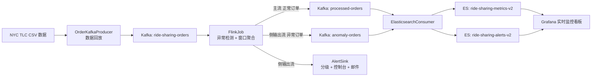

# 基于 Kafka 与 Flink 的网约车订单异常实时监控

实时读取网约车订单流水，用 Flink 做异常检测与窗口聚合，把正常指标和异常告警分流写入 Elasticsearch，由 Grafana 可视化，并对高等级异常触发邮件告警。异常判定阈值参照 NYC TLC 官方计费标准，原始数据来自 NYC TLC Yellow Trip 出租车流水。

## 系统架构



数据链路上有三条 Kafka topic，异常订单通过 Flink 侧输出流（`OutputTag`）与正常订单分离，各自落到不同的 ES 索引，指标看板和告警看板因此互不干扰。

## 技术栈

| 组件 | 版本 | 用途 |
|---|---|---|
| Java | 1.8（`maven.compiler.source/target`） | 运行语言 |
| Apache Flink | 1.17.0 | 流处理、窗口聚合、侧输出分流 |
| flink-connector-kafka | 1.17.0 | Kafka Source / Sink |
| Apache Kafka client | 3.5.0 | 消息收发 |
| Elasticsearch client | 7.17.29（rest-high-level-client） | 指标与告警存储 |
| Jackson | 2.15.0 | JSON 序列化 |
| javax.mail | 1.6.2 | 邮件告警 |
| Grafana | 需自行安装 | 可视化看板 |
| maven-shade-plugin | 3.4.1 | 打包 fat jar，产出 `dependency-reduced-pom.xml` |

## 功能特性

- 基于事件时间的乱序容忍（`forBoundedOutOfOrderness` 3 秒）与 10 秒滚动窗口营收聚合。
- Checkpoint 精确一次语义：10 秒触发、最小间隔 5 秒、超时 60 秒、并发数 1。
- 侧输出流分离异常订单，正常流与聚合流写 `processed-orders`，异常流写 `anomaly-orders`。
- Haversine 球面距离计算订单实际里程，避免直接用经纬度差值带来的误差。
- 三维异常判定：距离异常、价格异常（含价格非法、短途高价、超出 TLC 监管上限）。
- 告警分级（WARNING / ERROR / CRITICAL）与控制台告警，CRITICAL 与 ERROR 触发限流邮件。
- ES Bulk API 批量写入，文档 ID 由 `topic-partition-offset` 生成，重复消费天然幂等覆盖。
- 附带 Grafana 看板与 ES 数据源配置、Kafka topic 创建脚本。

## 目录结构

```text
.
├── pom.xml                          # 依赖、shade/exec 插件、三个运行 profile
├── dependency-reduced-pom.xml       # maven-shade-plugin 自动生成，无需手工维护
├── README.md
├── src/main/java/com/example/
│   ├── FlinkJob.java                # 核心作业：检测、分流、聚合、双写 Kafka
│   ├── OrderKafkaProducer.java      # CSV 数据回放生产者
│   ├── ElasticsearchConsumer.java   # Kafka → Elasticsearch 落库
│   ├── model/
│   │   ├── Order.java               # 订单数据模型（Kafka 消息体）
│   │   └── AlertLevel.java          # 告警级别枚举
│   ├── sinks/
│   │   └── AlertSink.java           # 告警分级、控制台输出、邮件限流
│   └── utils/
│       ├── EmailUtils.java          # SMTP 发信（见「安全提示」）
│       └── AlertStrategy.java       # 早期分级策略，当前主链路未调用
├── grafana/
│   ├── dashboard.json               # 网约车订单实时监控看板
│   └── datasource.json              # Elasticsearch 数据源
└── kafka/
    ├── kafka-topics.bat             # Windows 创建三个 topic
    ├── kafka-topics.sh              # Linux/macOS 创建 topic
    └── fix-kafka.bat                # 本机 Kafka 故障恢复脚本（路径写死）
```

## 环境要求

- JDK 8 或 11（`pom.xml` 编译目标为 1.8，Flink 1.17 官方支持 Java 8/11），Maven 3.6+
- Kafka 3.5.x（默认 `localhost:9092`，KRaft 或 ZooKeeper 模式均可）
- Elasticsearch 7.17.x（默认 `localhost:9200`）
- Grafana（可选，用于看板展示）

## 快速开始

### 1. 启动 Kafka

```bash
# ZooKeeper 模式
bin/zookeeper-server-start.sh config/zookeeper.properties
bin/kafka-server-start.sh config/server.properties
```

### 2. 创建 Topic

仓库内脚本使用 `bin/windows/kafka-topics.bat` 这类相对路径，需要在 Kafka 安装根目录下执行，或把脚本里的路径改成你的 Kafka 绝对路径。

```bash
# Windows：将 kafka/kafka-topics.bat 复制到 Kafka 安装根目录后运行
kafka-topics.bat

# Linux/macOS：脚本里 replication-factor 为 2，单节点请改成 1
bin/kafka-topics.sh --create --topic ride-sharing-orders  --bootstrap-server localhost:9092 --partitions 4 --replication-factor 1
bin/kafka-topics.sh --create --topic processed-orders      --bootstrap-server localhost:9092 --partitions 4 --replication-factor 1
bin/kafka-topics.sh --create --topic anomaly-orders       --bootstrap-server localhost:9092 --partitions 4 --replication-factor 1
```

三个 topic 分区数均为 4，与 Flink 并行度 4 对应。

### 3. 准备数据文件

`OrderKafkaProducer` 从进程工作目录读取常量 `CSV_FILE_PATH` 指定的文件，默认 `yellow_tripdata_2026-01.parquet.csv`（第一行为表头）。该数据文件不随仓库分发，需要自行下载 NYC TLC Yellow Trip 数据并转成 CSV，且至少 17 列。当前解析规则为固定列位：

| 列序号（从 0 开始） | 含义 | 处理方式 |
|---|---|---|
| 7 | Pickup LocationID | 映射为 NYC 范围内的起点经纬度 |
| 8 | Dropoff LocationID | 映射为 NYC 范围内的终点经纬度 |
| 16 | 金额 | 价格，`< 0` 或 `> 500` 的行直接丢弃 |

经纬度是按 LocationID 线性映射出来的模拟坐标，并非真实站点坐标：纬度取 `locationId % 1000` 归一化、经度取 `(locationId × 7) % 1000` 归一化，再分别落到 NYC 矩形范围（纬度 40.5–40.9，经度 −74.3 至 −73.7）内。`orderId` 为 `order-` 加 8 位随机串，`timestamp` 取发送时刻而非 CSV 里的原始行程时间，`driverId` 在 50 个、`passengerId` 在 200 个 ID 内循环。如需换文件路径或支持命令行传参，目前要改 `CSV_FILE_PATH` 常量，`main` 方法尚未读取 `args`。

### 4. 编译打包

```bash
mvn clean package
```

产物在 `target/`，shade 插件会把依赖一并打入 fat jar。

### 5. 启动组件

按以下顺序开三个终端，`pom.xml` 里的 `producer` / `flink` / `es-consumer` 三个 profile 分别对应三个入口类。

```bash
# 终端 1：Kafka → Elasticsearch 落库
mvn exec:java -P es-consumer

# 终端 2：Flink 作业（启动后访问 http://localhost:8081 看 Web UI）
mvn exec:java -P flink

# 终端 3：回放订单数据
mvn exec:java -P producer
```

生产者每发一条默认 `Thread.sleep(100)` 限速，压测时把那行注释掉。数据流跑起来后，控制台会周期性输出「已发送 N 条订单」「成功写入 N 条指标数据」，异常订单会实时打印 `[ALERT]` 行。

### 6. 导入 Grafana

先导入 `grafana/datasource.json` 创建 Elasticsearch 数据源（名称 `Elasticsearch`，地址 `http://localhost:9200`，索引模式 `ride-sharing-metrics-*`，时间字段 `timestamp`，ES 版本 7.0.0，设为默认），再在 Dashboards 里 Import `grafana/dashboard.json`。看板面板直接引用 `ride-sharing-metrics-v2` 和 `ride-sharing-alerts-v2` 两个具体索引，若改动 ES 索引名需同步更新 `ElasticsearchConsumer` 常量、`dashboard.json` 和 `datasource.json`。

看板 `uid` 为 `ride-sharing-monitor-v4`，默认刷新间隔 5 秒、时间范围 `now-1h`、时区跟随浏览器，全部面板以 `timestamp` 作为时间字段。9 个面板的数据来源如下：

| 面板 | 可视化类型 | 索引 | ES 查询 |
|---|---|---|---|
| 总订单数 | stat | ride-sharing-metrics-v2 | count |
| 异常订单数 | stat | ride-sharing-alerts-v2 | count |
| 实时总营收(元) | stat | ride-sharing-metrics-v2 | sum(price) |
| 异常订单数(最近) | stat | ride-sharing-alerts-v2 | count |
| 订单数量趋势 | timeseries | ride-sharing-metrics-v2 | count，按 timestamp 分桶 |
| 异常订单趋势 | timeseries | ride-sharing-alerts-v2 | count，按 timestamp 分桶 |
| 订单价格分布 | table | ride-sharing-metrics-v2 | count，按 price 分桶 |
| 异常类型分布 | barchart | ride-sharing-alerts-v2 | count，按 anomalyType.keyword 分桶 |
| 异常告警列表 | table | ride-sharing-alerts-v2 | logs，取最近 50 条 |

## 异常检测规则

判定在 `FlinkJob.OrderProcessFunction` 中完成，命中任一规则即打上 `anomalyType` 标签并转入侧输出流，否则进入正常流。

| 规则 | 判定条件 | 异常类型 |
|---|---|---|
| 距离异常 | 起终点 Haversine 距离 > 50 km | 距离异常 |
| 价格非法 | `price <= 0` | 价格异常 |
| 短途高价 | 距离 < 0.1 km 且 `price` > 15.0 | 价格异常 |
| 超出监管上限 | `price` > 3.00 + 2.17 × 距离(km) + 25.0 | 价格异常 |
| 同时命中距离与价格 | 上述两类同时成立 | 距离异常+价格异常 |

TLC 模型中 3.00 是起步价、2.17 是每公里费率、25.0 是对等候费、夜间附加费、过桥费与拥堵的容忍度。50 km 的距离阈值参照 NYC 最大对角线里程约 65 km 设定，用于捕获跨城异常长途或 GPS 漂移。

## 告警分级与通知

`AlertSink` 以并行度 1 运行，按 `anomalyType` 定级，控制台始终输出，高等级触发邮件。

| 级别 | 触发条件 | 通知动作 |
|---|---|---|
| CRITICAL | 价格异常与距离异常同时命中 | 控制台 + 邮件 |
| ERROR | 仅价格异常 | 控制台 + 邮件 |
| WARNING | 仅距离异常 | 仅控制台 |

邮件限流为 30 秒内最多一封，用 `AtomicLong` 加 CAS 保证并发下不重复发送。`AlertLevel` 与 `utils/AlertStrategy.java` 是最早一版分级方案（按价格和坐标距离差值分档，并模拟短信告警），现行链路未调用，保留作参考。

## 数据契约

Kafka 消息 value 为 `Order` 的 JSON 序列化结果，key 为 `orderId`。

| 字段 | 类型 | 说明 |
|---|---|---|
| orderId | String | 订单唯一标识 |
| timestamp | long | 毫秒时间戳，作为 Flink 事件时间与 Grafana 时间字段 |
| startLat / startLng | double | 起点纬度 / 经度 |
| endLat / endLng | double | 终点纬度 / 经度 |
| price | double | 订单金额 |
| driverId / passengerId | String | 司机 / 乘客标识 |
| anomalyType | String | 异常类型，正常订单为 null，由 Flink 写入 |

窗口聚合记录同样写入 `processed-orders`：`orderId` 为 `aggregated-` 加时间戳、`driverId` 为 `AGGREGATED`、`passengerId` 为 `WINDOW_SUM`、`price` 为窗口内金额累加。这类记录与订单明细混在同一个 topic 和同一个 ES 索引里，看板的营收面板是无过滤的 `sum(price)`，因此每笔订单会被明细和聚合各计入一次，读数高于真实营收；要拿到明细口径，按 `driverId != AGGREGATED` 过滤即可。

`ElasticsearchConsumer` 写告警索引前会补算 `distance` 与 `pricePerKm` 两个字段，供看板的里程和单价展示使用。

## 核心配置项

参数目前以常量形式写在各类顶部，未按外部配置文件抽取，改环境需修改源码。

| 位置 | 常量 | 默认值 |
|---|---|---|
| FlinkJob | KAFKA_BOOTSTRAP_SERVERS | localhost:9092 |
| FlinkJob | SOURCE_TOPIC / PROCESSED_TOPIC / ANOMALY_TOPIC | ride-sharing-orders / processed-orders / anomaly-orders |
| FlinkJob | CONSUMER_GROUP | flink-ride-sharing-group |
| FlinkJob | 并行度 / Checkpoint 间隔 | 4 / 10000 ms |
| FlinkJob | rest.port | 8081（Flink Web UI） |
| FlinkJob | DISTANCE_ANOMALY_THRESHOLD_KM | 50.0 |
| FlinkJob | TLC_BASE_FARE / TLC_PRICE_PER_KM / TLC_TOLERANCE | 3.00 / 2.17 / 25.0 |
| FlinkJob | SHORT_TRIP_DISTANCE_KM / SHORT_TRIP_MAX_PRICE | 0.1 / 15.0 |
| OrderKafkaProducer | CSV_FILE_PATH / TOPIC | yellow_tripdata_2026-01.parquet.csv / ride-sharing-orders |
| ElasticsearchConsumer | GROUP_ID | elasticsearch-consumer-group |
| ElasticsearchConsumer | ELASTICSEARCH_HOST / PORT | localhost / 9200 |
| ElasticsearchConsumer | METRICS_INDEX / ALERTS_INDEX | ride-sharing-metrics-v2 / ride-sharing-alerts-v2 |
| ElasticsearchConsumer | max.poll.records / 自动提交间隔 | 500 / 1000 ms |
| AlertSink | EMAIL_INTERVAL_MS | 30000 ms |

## 部署到 Flink 集群

`FlinkJob.main` 当前用 `createLocalEnvironmentWithWebUI` 创建执行环境，以便本地打开 8081 的 Web UI；这会固定占用本机该端口。要提交到集群，把该行换回文件里注释掉的 `StreamExecutionEnvironment.getExecutionEnvironment()`，并给 Flink 核心依赖加回 `provided` scope（`pom.xml` 中已有注释标记），否则 fat jar 会与集群自带的 Flink 类冲突。

```bash
flink run -c com.example.FlinkJob target/kafka-flink-ride-sharing-monitor-1.0-SNAPSHOT.jar
```

## 常见问题

**Topic 创建报 `replication-factor` 相关错误。** `kafka/kafka-topics.sh` 写的是副本数 2，单节点集群必须改为 1；`kafka-topics.bat` 则依赖 Kafka 安装目录下的相对路径。

**Kafka 启动失败或日志目录损坏。** `kafka/fix-kafka.bat` 会强杀所有 `java.exe`、清空 `F:\tmp\kafka-logs` 并把 `log.dirs` 改写为 `F:/tmp/kafka-logs`，假定 Kafka 装在 `C:\kafka`。这是作者本机脚本，直接运行会删除 Kafka 已有数据，换机器前先核对路径并确认可以清空。

**8081 端口被占用。** Flink Web UI 与别的服务冲突时，改 `FlinkJob` 中 `conf.setInteger("rest.port", 8081)`。

**重启后看到重复告警。** Kafka Source 配置为 `OffsetsInitializer.earliest()`，作业重启会从头重放，ES 侧因文档 ID 固定会覆盖，但控制台与邮件告警会重复触发。

**看板无数据。** 确认 ES 里已生成 `ride-sharing-metrics-v2` / `ride-sharing-alerts-v2`、数据源时间字段为 `timestamp`、看板右上角时间范围覆盖到回放时刻；`timestamp` 是生产者发送时刻而非 CSV 原始行程时间。

## 安全提示

`EmailUtils.java` 把 SMTP 主机、发信邮箱和 163 授权码硬编码在源码中，且该文件已进入 git 历史。这类凭据一旦推送到远端就应当视为泄露：请先在邮箱后台作废并更换授权码，再改用环境变量或外部配置注入，凭据不要留在代码里。若要把已推送的历史提交中的凭据彻底清除，需要重写历史并强制推送，操作前确认没有他人基于旧提交协作。

## 已知限制

- 所有 Kafka、ES、阈值参数为源码常量，缺少 `application.properties` 之类的外部配置，多环境切换需改代码重新打包。
- 数据文件路径写死，且未支持命令行参数覆盖。
- `AlertSink` 邮件发送为同步阻塞调用，虽有限流仍在告警风暴时会拖慢该算子；并行度 1 也构成单点。
- 指标索引混合了订单明细与窗口聚合记录，而营收面板是无过滤的 `sum(price)`，读数重复计入，需要按 `driverId != AGGREGATED` 校正。
- 告警文案里金额单位写作「元」，而阈值取自 NYC TLC 美元计费标准，展示口径与数据源币种不一致。
- `OrderKafkaProducer` 逐行 `catch` 并静默跳过解析异常，缺少错误计数与坏数据采样日志。
- 项目暂无单元测试与 CI 配置，`junit` 依赖已引入但没有 `src/test` 目录。
